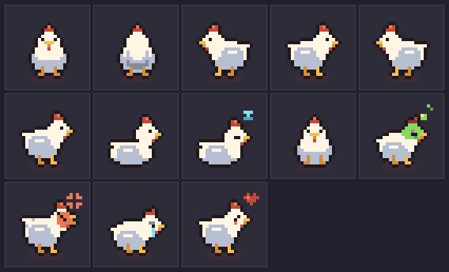
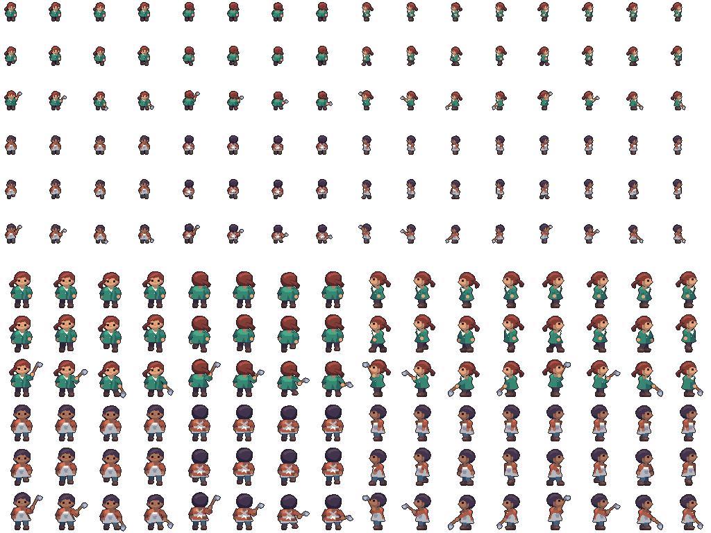
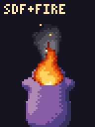
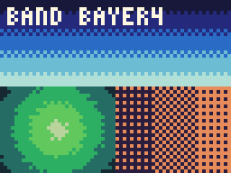
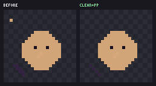
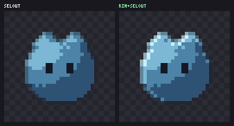
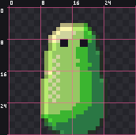
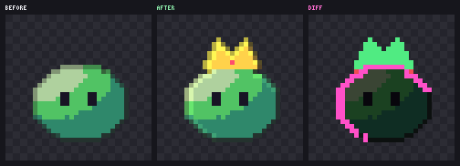
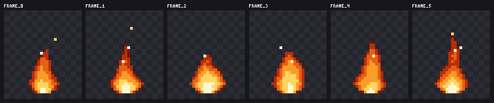

# pixelai-tools

**Deterministic, CLI-only pixel art, isometric architecture, tileset, and animation engine built for AI agents (Antigravity, Claude Code, Codex).**

Traditional image-generation models struggle with pixel art: they produce blurry mixels, inconsistent palettes, broken transparency, and misaligned sprite frames. **`pixelai-tools`** solves this by giving any AI agent a fast, declarative JSON DSL over `stdin` or file to render **pixel-perfect**, **palette-locked**, **game-ready** assets in a single terminal call.

---

## Showcase (100% Generated by AI Agents via CLI)

### Cozy Architecture, Nature & UI (`building`, `nature_rig`, `ui_rig`)
| Cozy Buildings & Ground Shadows | Orchard & Fruit Trees (`nature_rig`) | Native Pixel Inventory UI (`ui_rig`) |
| :---: | :---: | :---: |
|  |  |  |

### Animated Creatures, Characters & RPG Items (`.gif` + Spritesheets + Godot 4 `.tres`)
| Chicken Pack Showcase (`pack chicken`) | Cow Pack Showcase (`pack cow`) | Enchanted Lanterns (`item_rig` + `fx`) |
| :---: | :---: | :---: |
|  |  |  |

### Characters, Isometric Architecture & Wang Autotiles
| 4-Direction Human Rigs (`char_rig`) | Cozy Isometric Barn (`iso_structure`) | 16-Tile Water/Grass Wang Autotile |
| :---: | :---: | :---: |
|  |  |  |

### Organic SDF Solids, Flow FX, `spine_rig` & Nature Animation
| Full-Body `spine_rig` Walk Cycle | Animated Sakura Tree (`sakura_64`) | Seeded Nature Variants (`nature_rig`) |
| :---: | :---: | :---: |
|  |  |  |

| SDF Metaballs + FBM `flame` & `smoke` | 2-Bone `ik_limb` + Spine `bend`/`wave` | Band-Edge Bayer 4×4 & `hue_ramp` |
| :---: | :---: | :---: |
|  |  |  |

### Post-Processing & AI-Agent Visual Diagnostics
| `cleanup` + `pixel_perfect` | `rim_light` Before `selout` | CLI `--ruler` Coordinate Grid |
| :---: | :---: | :---: |
|  |  |  |

| `pixelai diff` (`BEFORE \| AFTER \| DIFF`) | `render --contact-sheet` Frame Strip |
| :---: | :---: |
|  |  |

---

## Why `pixelai-tools`?

- **Zero Mixels, Zero Blur:** Pure integer pixel math, Bresenham lines, midpoint circles, and nearest-neighbor scaling/rotation.
- **Built-In Aesthetic Standard:** Defaults to **Lineless Interior + 1px External Outline** (`ext_outline`) with automatic specular bevels, eave/ground shadows, and recessed depth—or `--lineless` for **Pure Lineless**.
- **Organic SDF Solids, Flow FX & Spine Rigging:** Smooth-min SDF metaballs (`solid`), deterministic FBM `flame` & `smoke`, 2-bone analytical `ik_limb`, and inverse-bilinear `bend`/`wave` spine deformation.
- **Band-Edge Bayer 4×4 Dithering & Post-Processing:** `band_gradient` (flat color bands with Bayer 4×4 dithering strictly along band transitions), `hue_ramp`, `cleanup` (removes orphan/stray pixels while preserving high-contrast details like eyes), `pixel_perfect`, and `rim_light` before `outline`/`selout`.
- **2:1 Isometric Engine (`iso_structure`):** Automatic back-to-front 3D depth sorting (`gx + gy, gz`), pyramidal/gable roofs, and sloped walls with arches.
- **Built for AI Agents:** Modular `guide --list` / `guide --op <name>`, `schema` (JSON Schema), fuzzy field-typo linting, structured JSON errors on `--json`, visual `diff`, `--ruler` coordinate grids, `--contact-sheet` previews, plus `edge_quality`, `color_histogram`, and `frame_deltas` in `inspect`.
- **Game-Engine Ready:** Exports lossless `.png`, transparent looping `.gif`, spritesheet `.png` + `.json` metadata, and **Godot 4 `SpriteFrames` (`.tres`)**.
- **Self-Contained PNGs:** Every `.png` embeds its source JSON spec in `tEXt` metadata (`pixelai extract sprite.png`), allowing agents to inspect, extend (`"extends": "sprite.png"`), and animate existing sprites without redrawing from scratch.
- **Curated Palettes:** Includes `cozy24`, `endesga32`, `sweetie16`, `pico8`, `gameboy`, and `mistria_portrait` (extensible via `palette_ext`).

---

## Quick Start

### Requirements
- Python 3.11+
- `Pillow >= 10.0.0`

```powershell
pip install -e .
```

### CLI Commands

```powershell
# Compact op index or single-op reference (token-efficient for AI agents)
pixelai guide --list
pixelai guide --op solid
pixelai schema

# Render PNG from file or stdin ('-') with optional coordinate ruler
pixelai render spec.json -o sprite.png --ruler ruler.png

# Render Pure Lineless (no external outline)
pixelai render spec.json -o sprite_lineless.png --lineless

# Render transparent animated GIF + labeled checkerboard contact sheet
pixelai render anim.json -o walk.gif --fps 8 --contact-sheet preview.png

# Render Spritesheet + JSON Metadata + Godot 4 SpriteFrames (.tres)
pixelai render anim.json -o sheet.png --sheet --columns 4 --meta sheet.json --godot sheet.tres

# Compare two sprites pixel-by-pixel (BEFORE | AFTER | DIFF + JSON metrics)
pixelai diff before.png after.png -o diff.png --json

# Inspect PNG/GIF metrics (edge_quality, color_histogram, frame_deltas) + ASCII + ruler
pixelai inspect sprite.png --ascii --ruler ruler.png

# Extract embedded JSON spec from any generated PNG
pixelai extract sprite.png
```

Animation specs may provide `"durations_ms": [100, 300, 100]` with one positive
duration per rendered frame, and named clips such as
`"clips": {"attack": {"frames": [0, 1, 2], "loop": false}}`.
Spritesheet metadata preserves both; Godot exports named animations with
duration weights. GIF previews preserve frame holds with GIF timing rounded to
10 ms and a minimum of 20 ms. A GIF preview plays the complete frame sequence;
clip selection belongs to the metadata/runtime.

---

## Validate and automate renders

### Experimental managed production

The autonomous production foundation provides a persistent agent task queue,
stage-specific contracts, hash-bound file evidence, downstream invalidation,
repair tasks and submission budgets. Initialize a project with a JSON brief
containing a nonempty `goal`, then use:

```sh
pixelai project init my-project --brief brief.json
pixelai workflow start my-project --json
pixelai workflow next my-project --json
pixelai workflow submit my-project --task 1 --input response.json
pixelai workflow resume my-project --json
```

Each task reports its required output. Evidence records use paths relative to
the project, for example `{"evidence":[{"path":"art/sprite.png"}]}`. Changing
accepted evidence reopens dependent tasks. Reviews below 3/4 request repair.
Review context identities are currently declarations, not host-authenticated
isolation. The experimental workflow never grants production approval.

Review tasks provide a `review_packet` with every frame at native size and
4x nearest-neighbor zoom. Use a separate context for each reviewer and supply
its `packet_id`, every view path in `inspected_views`, and the view records in
the submission's `evidence` array. Missing views or stale packet identities
cannot advance the task. Packets omit author justifications and peer scores;
creating or declaring coverage of a packet does not attest actual observation.
Construction submissions bind `source_path` and `image_path` to evidence
files. Atlas PNGs also require `manifest_path`; each native frame, duration
and named clip must match the source. GIF previews are checked after the
renderer's palette and timing conversion.

The alternatives stage requires six proposal records with distinct `id` and
`structure` values plus `source_path` and `image_path` evidence. Every proposal
is rerendered and must match the contracted native dimensions. Identical
rendered proposals are rejected; pairwise silhouette diagnostics are recorded
for review. Pixel differences alone do not establish meaningful design variety.

Generate universal metadata directly with
`pixelai render source.json -o art/sheet.png --manifest asset.json --json`.
The source must declare `asset_id` and a `runtime` object with explicit
`pivot`, `ground_anchor` and `sort_origin` coordinate pairs. Optional `regions`
and `sockets` use the same native coordinates. `runtime.frame_overrides` maps
rendered frame index strings to coordinate/region/socket overrides.
Coordinates are attached before post-processing and follow padding and integer
scaling automatically. The output texture must be inside the manifest's
directory. Metadata includes actual atlas regions, the texture hash, durations,
clips and declared transitions. Output artifacts cannot share a path or
overwrite the source specification.

Managed contracts can declare a structured `delivery` object containing
`views`, `actions`, `states`, `required_combinations` and `distinct_views`.
Runtime frame records carry explicit `view`, `action` and `state` tags through
`runtime` defaults or per-frame overrides. For example:

```json
{"views":["down","up","left","right"],"actions":["idle","walk"],
 "states":["healthy","hurt"],"distinct_views":true,
 "required_combinations":[{"view":"down","action":"walk","state":"healthy"}]}
```

Coverage checks require the named tags and each explicitly valid combination;
they do not invent a Cartesian product of incompatible gameplay states. Only
frames reachable from exported clips count. When requested, distinct views
cannot consist of identical frame-content sets. These checks establish
coverage, not correct anatomy, state semantics or animation quality.

Rejected managed constructions cannot be resubmitted unchanged under the same
delivery contract merely to obtain another review. Renaming, PNG metadata and
transparent padding do not make new visual content. Artistic defects require
changed pixels; purely technical/game-readiness defects can be repaired through
changed runtime metadata while preserving artwork. Keep contract evidence
separate from mutable construction files so normal iteration does not reopen
the initial contract unnecessarily.

`pixelai simulate asset.manifest.json --json` validates exported regions,
texture identity, coordinates and clip timing. It reports unverified runtime
behaviors explicitly. `pixelai diversity first.png second.png --json` provides
approximate silhouette similarity diagnostics, not artistic approval.

`pixelai scene scene.json --output preview --json` renders native contextual
frames from exported manifests, with pivot placement, clip timing and stable
Y sorting. The output directory must be new. The bundle contains PNG frames
and a `trace.json` report. A scene uses:

```json
{"schema_version":1,"width":320,"height":180,"background":"#404048",
 "times_ms":[0,100,400],
 "actors":[{"id":"hero","manifest":"hero/asset.json","clip":"idle","position":[160,120]}]}
```

Actor positions locate each frame's pivot in world pixels. Manifest and texture
paths remain relative to their containing files. This reference compositor
does not yet resolve movement collision, transition blending, artistic quality or seams.

Frames may declare `regions` containing `{id, role, polygon}` records. Supported
roles are `collision`, `hit`, `hurt`, `interaction` and `occluder`. Polygons use
native frame coordinates and must be finite, nondegenerate and convex; use
multiple convex regions for a concave footprint. Scene traces report overlaps
with roles preserved. Boundary contact is not penetration. Set
`"debug_regions": true` for visual outlines. Overlap diagnostics do not resolve
movement or prove a complete physics implementation.

An actor's optional `timeline` is an ordered array of `{at_ms, clip, position}`
events. Each event can change clip, position or both; times must increase
strictly. Position-only changes keep clip phase. An explicit clip restarts its
phase. Changes between different clips require an exported `transitions` edge
such as `{"from":"idle","to":"attack"}`. A clip with
`"interruptible": false` cannot be replaced or restarted before its duration.
These checks validate declared state changes, not transition blending or acting.

`pixelai tilecheck atlas.png --mode wang16 --tile-size 16 --output tile-review`
creates a legal-neighborhood mosaic at native and 4x size, comparison sheets
for all 128 legal horizontal/vertical Wang16 edge pairs, and `seams.json` with
comparison rectangles and premultiplied RGBA edge deltas. Use `--mode repeat`
for a single bounded texture's repetition trial. Edge deltas are diagnostics;
the result remains `needs_visual_review`. Temporal seams and Blob47 are not
verified by this command.

See [AUTONOMOUS_ROADMAP.md](AUTONOMOUS_ROADMAP.md) for implemented capabilities,
remaining stages and acceptance criteria.

### Growth-driven broadleaf architecture

For oak, fruit and sakura trees, opt into a growth graph:

```json
{"op":"nature_rig","kind":"tree","variant":"oak","w":64,"h":78,
 "seed":41,"growth":{"profile":"forked","spread":1.0,"thickness":1.0,"root_span":1.0}}
```

Profiles are `upright`, `forked`, `multi_stem`, `gnarled`, `leaning` and
`windswept`. The graph drives trunk bends, branch topology, roots and canopy
supports together. Optional `lean` is in [-1,1], `spread` in [0.6,1.25],
`thickness` in [0.6,1.8] and `root_span` in [0.6,1.5]. Explicit zero lean is
honored. Native dimensions must be at least 32x40. Pine growth graphs are not
implemented; unsupported combinations fail explicitly.

Use `trunk_only:true` with `shadow:false` to inspect roots and boughs without
foliage. `specs/growth_profiles.json` pairs all six full and trunk-only renders.
Existing specs retain their legacy tree geometry unless `growth` is present.
These profiles are structural alternatives, not commercial quality approvals.

`pixelai structure first.json --compare second.json --json` compares rendered
growth topology, normalized geometry and reflected geometry. `--full` includes
graph records. Labels and palette changes do not count as structural changes;
translation and integer scaling do not make a copied graph new. Managed
proposal reports include these comparisons automatically when both proposals
contain growth graphs. The current command does not yet analyze other asset
families or certify visual originality.

### Named structural parts

The `assembly` operation renders a graph of named parts. Each part declares
`id`, native `width`/`height`, local drawing `ops`, an optional `parent` id,
integer `offset`, `z` draw order and a descriptive `material`. Child offsets
are relative to the parent's origin. Moving a parent moves its children.
Part origins survive padding and integer scaling in exported attachments.
Missing parents, cycles, duplicate IDs and unknown part fields are errors.

```json
{"op":"assembly","parts":[
  {"id":"torso","width":12,"height":16,"offset":[10,8],
   "ops":[{"op":"rect","x":0,"y":0,"w":12,"h":16,"color":"#448855"}]},
  {"id":"arm","parent":"torso","width":4,"height":10,"offset":[12,2],
   "ops":[{"op":"rect","x":0,"y":0,"w":4,"h":10,"color":"#669966"}]}
]}
```

This initial assembly contract supports translation and draw order. It does
not yet solve anatomical constraints, rotations, contact physics or automatic
structural diversity. Use explicit `frame_count` for animation nested in parts.

New artwork can enforce generation without imported assets:

```powershell
pixelai validate ./specs/new_asset.json --fresh
pixelai render ./specs/new_asset.json -o ./new_asset.png --fresh --json
```

`--fresh` (or top-level `"fresh": true`) rejects `extends` and `load_png`
throughout definitions, layers, frames and keyframes. Local procedural stamps
remain available. This prevents file reuse; it does not detect copied geometry
or decide whether a design was previously rejected. Rejected assets must never
be used as the basis of a new delivery.

Surface accents support `rock`, `soil`, `leaves`, `bark`, `water`, and `cloth`
alongside `wood`, `grass`, `brick`, `cobble`, and `shingle`. Use `scatter` with
`target_color` or `inside:true` to preserve the silhouette. Render UI at final
native dimensions rather than stretching a small exported panel. Building
ground shadows use a straight projection with `shadow_opacity: 0.22` by default;
PNG preserves partial transparency.

```powershell
pixelai validate ./specs/bush_64.json
pixelai render ./specs/bush_64.json -o ./bush.png --json
```

`validate` runs the renderer in memory and reports the first error or a JSON
summary with warnings. `render --json` writes one JSON result to stdout with
absolute artifact paths, frame dimensions, frame count, and warnings.

## Commercial review gate

`inspect` reports measurable raster facts; it does not judge whether art is
professional. Commercial candidates use a fail-closed independent review:

```powershell
pixelai qa output.png --template reviews/output.review.json
# Complete the template after viewing 1x and integer zoom with a named reference.
pixelai qa output.png --review reviews/output.review.json --catalog reviews/catalog.json --record
```

The eleven required decisions cover professional quality, native readability,
pixel clustering, color and lighting, materials, specialized design, detail,
originality, catalog consistency, technical integrity, and game readiness. Every
pass requires written evidence. The generator cannot approve its own output.
Exit code `0` is approved, `1` rejected, and `2` awaiting evidence. Rejected
pixel content remains rejected after renaming, metadata changes, or transparent
padding; its entry stays in the append-only catalog.

Procedural material planes are available through `material` for rock, cobble,
soil, leaves, bark, grass, water, cloth, wood, and roof. They use structured
shade planes and seeded geometry. They are bounded surfaces, not seamless
autotiles.
Errors go to stderr and return a nonzero exit code.

Relative `extends` and `load_png` input paths resolve from the spec file's
directory, or from the working directory for stdin. Inherited operations use
their parent spec's directory. Output flags resolve from the working directory.
Embedded specs record resolved asset paths when external files are referenced.

## Local Codex plugin

From the repository root, using Python 3.11 or newer:

```powershell
python -m pip install .
codex plugin marketplace add .
codex plugin add pixelai-tools@pixelai-local
```

Open a Codex chat with PixelAI Tools and request a sprite or animation in your
workspace. The plugin uses the local Python CLI and the included art skills.
For development checks, run `python -m unittest discover -s tests -q`.

## Agent Integration (Antigravity, Claude Code, Codex)

Drop [SKILL.md](SKILL.md) into your project or let your agent run `python -m pixelai.cli guide` to discover the full JSON DSL, isometric primitives, and palette keys in a single call.

## License
MIT
