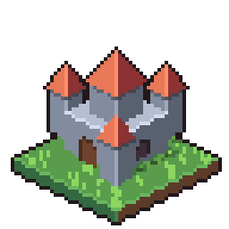
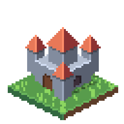
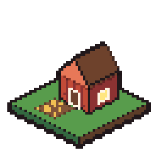
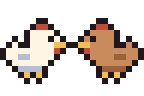
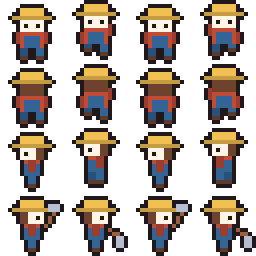

# pixelai-tools

**Deterministic, CLI-only pixel art, isometric architecture, tileset, and animation engine built for AI agents (Antigravity, Claude Code, Codex).**

Traditional image-generation models struggle with pixel art: they produce blurry mixels, inconsistent palettes, broken transparency, and misaligned sprite frames. **`pixelai-tools`** solves this by giving any AI agent a fast, declarative JSON DSL over `stdin` or file to render **pixel-perfect**, **palette-locked**, **game-ready** assets in a single terminal call.

---

## Showcase (100% Generated by AI Agents via CLI)

### Isometric Architecture (`ext_outline` vs. `--lineless`)
| Default (`ext_outline`: Lineless Interior + 1px External Outline) | Pure Lineless (`--lineless`) | Cozy Barn (`gable_left` Roof + Wood Texture) |
| :---: | :---: | :---: |
|  |  |  |

### Animated Characters & Cozy Animals (`.gif` + Spritesheets + Godot 4 `.tres`)
| 64×64 Native Farmer Chopping | 16×16 Farmer Walk | Pecking Chickens (`stamp` + `remap`) |
| :---: | :---: | :---: |
|  |  |  |

### 16-Tile Wang Autotiles & Multi-Direction Rigs
| 16-Tile Water/Grass Wang Autotile | 4-Direction + Work Character Rig (`char_rig`) |
| :---: | :---: |
|  |  |

---

## Why `pixelai-tools`?

- **Zero Mixels, Zero Blur:** Pure integer pixel math, Bresenham lines, midpoint circles, and nearest-neighbor scaling/rotation.
- **Built-In Aesthetic Standard:** Defaults to **Lineless Interior + 1px External Outline** (`ext_outline`) with automatic specular bevels, eave/ground shadows, and recessed depth—or `--lineless` for **Pure Lineless**.
- **2:1 Isometric Engine (`iso_structure`):** Automatic back-to-front 3D depth sorting (`gx + gy, gz`), pyramidal/gable roofs, and sloped walls with arches.
- **Game-Engine Ready:** Exports lossless `.png`, transparent looping `.gif`, spritesheet `.png` + `.json` metadata, and **Godot 4 `SpriteFrames` (`.tres`)**.
- **Self-Contained PNGs:** Every `.png` embeds its source JSON spec in `tEXt` metadata (`pixelai extract sprite.png`), allowing agents to inspect, extend (`"extends": "sprite.png"`), and animate existing sprites without redrawing from scratch.
- **Curated Palettes:** Includes `cozy24`, `endesga32`, `sweetie16`, `pico8`, and `gameboy` (extensible via `palette_ext`).

---

## Quick Start

### Requirements
- Python 3.11+
- `Pillow >= 10.0.0`

```powershell
pip install -e .
```

### CLI Commands

```powershell
# Print complete LLM agent reference & built-in palettes
python -m pixelai.cli guide

# Render PNG from file or stdin ('-')
python -m pixelai.cli render spec.json -o sprite.png

# Render Pure Lineless (no external outline)
python -m pixelai.cli render spec.json -o sprite_lineless.png --lineless

# Render transparent animated GIF
python -m pixelai.cli render anim.json -o walk.gif --fps 8

# Render Spritesheet + JSON Metadata + Godot 4 SpriteFrames (.tres)
python -m pixelai.cli render anim.json -o sheet.png --sheet --columns 4 --meta sheet.json --godot sheet.tres

# Inspect PNG metrics (bounding box, margins, color count) + ASCII preview
python -m pixelai.cli inspect sprite.png --ascii

# Extract embedded JSON spec from any generated PNG
python -m pixelai.cli extract sprite.png
```

---

## Validate and automate renders

```powershell
pixelai validate ./specs/bush_64.json
pixelai render ./specs/bush_64.json -o ./bush.png --json
```

`validate` runs the renderer in memory and reports the first error or a JSON
summary with warnings. `render --json` writes one JSON result to stdout with
absolute artifact paths, frame dimensions, frame count, and warnings.
Errors go to stderr and return a nonzero exit code.

Relative `extends` and `load_png` input paths resolve from the spec file's
directory, or from the working directory for stdin. Inherited operations use
their parent spec's directory. Output flags resolve from the working directory.
Embedded specs record resolved asset paths when external files are referenced.

## Local Codex plugin

From the repository root, using Python 3.11 or newer:

```powershell
python -m pip install .
codex plugin marketplace add .
codex plugin add pixelai-tools@pixelai-local
```

Open a Codex chat with PixelAI Tools and request a sprite or animation in your
workspace. The plugin uses the local Python CLI and the included art skills.
For development checks, run `python -m unittest discover -s tests -q`.

## Agent Integration (Antigravity, Claude Code, Codex)

Drop [SKILL.md](SKILL.md) into your project or let your agent run `python -m pixelai.cli guide` to discover the full JSON DSL, isometric primitives, and palette keys in a single call.

## License
MIT
