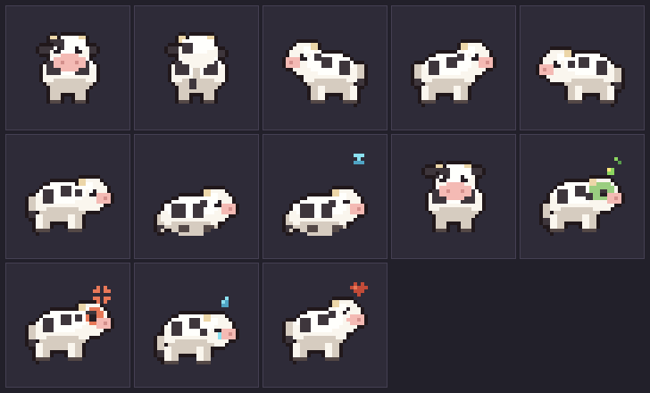
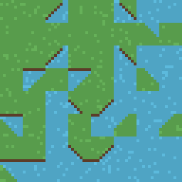

# pixelai-tools

**Deterministic, CLI-only pixel art, isometric architecture, tileset, and animation engine built for AI agents (Antigravity, Claude Code, Codex).**

Traditional image-generation models struggle with pixel art: they produce blurry mixels, inconsistent palettes, broken transparency, and misaligned sprite frames. **`pixelai-tools`** solves this by giving any AI agent a fast, declarative JSON DSL over `stdin` or file to render **pixel-perfect**, **palette-locked**, **game-ready** assets in a single terminal call.

---

## Showcase (100% Generated by AI Agents via CLI)

### Cozy Architecture, Nature & UI (`building`, `nature_rig`, `ui_rig`)
| Cozy Buildings & Ground Shadows | Orchard & Fruit Trees (`nature_rig`) | Native Pixel Inventory UI (`ui_rig`) |
| :---: | :---: | :---: |
|  |  |  |

### Animated Creatures, Characters & RPG Items (`.gif` + Spritesheets + Godot 4 `.tres`)
| Chicken Pack Showcase (`pack chicken`) | Cow Pack Showcase (`pack cow`) | Enchanted Lanterns (`item_rig` + `fx`) |
| :---: | :---: | :---: |
|  |  |  |

### Characters, Isometric Architecture & Wang Autotiles
| 4-Direction Human Rigs (`char_rig`) | Cozy Isometric Barn (`iso_structure`) | 16-Tile Water/Grass Wang Autotile |
| :---: | :---: | :---: |
|  |  |  |

---

## Why `pixelai-tools`?

- **Zero Mixels, Zero Blur:** Pure integer pixel math, Bresenham lines, midpoint circles, and nearest-neighbor scaling/rotation.
- **Built-In Aesthetic Standard:** Defaults to **Lineless Interior + 1px External Outline** (`ext_outline`) with automatic specular bevels, eave/ground shadows, and recessed depth—or `--lineless` for **Pure Lineless**.
- **Organic SDF Solids, Flow FX & Spine Rigging:** Smooth-min SDF metaballs (`solid`), deterministic FBM `flame` & `smoke`, 2-bone analytical `ik_limb`, and inverse-bilinear `bend`/`wave` spine deformation.
- **Band-Edge Bayer 4×4 Dithering & Post-Processing:** `band_gradient` (flat color bands with Bayer 4×4 dithering strictly along band transitions), `hue_ramp`, `cleanup` (removes orphan/stray pixels while preserving high-contrast details like eyes), `pixel_perfect`, and `rim_light` before `outline`/`selout`.
- **2:1 Isometric Engine (`iso_structure`):** Automatic back-to-front 3D depth sorting (`gx + gy, gz`), pyramidal/gable roofs, and sloped walls with arches.
- **Built for AI Agents:** Modular `guide --list` / `guide --op <name>`, `schema` (JSON Schema), fuzzy field-typo linting, structured JSON errors on `--json`, visual `diff`, `--ruler` coordinate grids, `--contact-sheet` previews, plus `edge_quality`, `color_histogram`, and `frame_deltas` in `inspect`.
- **Game-Engine Ready:** Exports lossless `.png`, transparent looping `.gif`, spritesheet `.png` + `.json` metadata, and **Godot 4 `SpriteFrames` (`.tres`)**.
- **Self-Contained PNGs:** Every `.png` embeds its source JSON spec in `tEXt` metadata (`pixelai extract sprite.png`), allowing agents to inspect, extend (`"extends": "sprite.png"`), and animate existing sprites without redrawing from scratch.
- **Curated Palettes:** Includes `cozy24`, `endesga32`, `sweetie16`, `pico8`, `gameboy`, and `mistria_portrait` (extensible via `palette_ext`).

---

## Quick Start

### Requirements
- Python 3.11+
- `Pillow >= 10.0.0`

```powershell
pip install -e .
```

### CLI Commands

```powershell
# Compact op index or single-op reference (token-efficient for AI agents)
pixelai guide --list
pixelai guide --op solid
pixelai schema

# Render PNG from file or stdin ('-') with optional coordinate ruler
pixelai render spec.json -o sprite.png --ruler ruler.png

# Render Pure Lineless (no external outline)
pixelai render spec.json -o sprite_lineless.png --lineless

# Render transparent animated GIF + labeled checkerboard contact sheet
pixelai render anim.json -o walk.gif --fps 8 --contact-sheet preview.png

# Render Spritesheet + JSON Metadata + Godot 4 SpriteFrames (.tres)
pixelai render anim.json -o sheet.png --sheet --columns 4 --meta sheet.json --godot sheet.tres

# Compare two sprites pixel-by-pixel (BEFORE | AFTER | DIFF + JSON metrics)
pixelai diff before.png after.png -o diff.png --json

# Inspect PNG/GIF metrics (edge_quality, color_histogram, frame_deltas) + ASCII + ruler
pixelai inspect sprite.png --ascii --ruler ruler.png

# Extract embedded JSON spec from any generated PNG
pixelai extract sprite.png
```

---

## Validate and automate renders

New artwork can enforce generation without imported assets:

```powershell
pixelai validate ./specs/new_asset.json --fresh
pixelai render ./specs/new_asset.json -o ./new_asset.png --fresh --json
```

`--fresh` (or top-level `"fresh": true`) rejects `extends` and `load_png`
throughout definitions, layers, frames and keyframes. Local procedural stamps
remain available. This prevents file reuse; it does not detect copied geometry
or decide whether a design was previously rejected. Rejected assets must never
be used as the basis of a new delivery.

Surface accents support `rock`, `soil`, `leaves`, `bark`, `water`, and `cloth`
alongside `wood`, `grass`, `brick`, `cobble`, and `shingle`. Use `scatter` with
`target_color` or `inside:true` to preserve the silhouette. Render UI at final
native dimensions rather than stretching a small exported panel. Building
ground shadows use a straight projection with `shadow_opacity: 0.22` by default;
PNG preserves partial transparency.

```powershell
pixelai validate ./specs/bush_64.json
pixelai render ./specs/bush_64.json -o ./bush.png --json
```

`validate` runs the renderer in memory and reports the first error or a JSON
summary with warnings. `render --json` writes one JSON result to stdout with
absolute artifact paths, frame dimensions, frame count, and warnings.

## Commercial review gate

`inspect` reports measurable raster facts; it does not judge whether art is
professional. Commercial candidates use a fail-closed independent review:

```powershell
pixelai qa output.png --template reviews/output.review.json
# Complete the template after viewing 1x and integer zoom with a named reference.
pixelai qa output.png --review reviews/output.review.json --catalog reviews/catalog.json --record
```

The eleven required decisions cover professional quality, native readability,
pixel clustering, color and lighting, materials, specialized design, detail,
originality, catalog consistency, technical integrity, and game readiness. Every
pass requires written evidence. The generator cannot approve its own output.
Exit code `0` is approved, `1` rejected, and `2` awaiting evidence. Rejected
pixel content remains rejected after renaming, metadata changes, or transparent
padding; its entry stays in the append-only catalog.

Procedural material planes are available through `material` for rock, cobble,
soil, leaves, bark, grass, water, cloth, wood, and roof. They use structured
shade planes and seeded geometry. They are bounded surfaces, not seamless
autotiles.
Errors go to stderr and return a nonzero exit code.

Relative `extends` and `load_png` input paths resolve from the spec file's
directory, or from the working directory for stdin. Inherited operations use
their parent spec's directory. Output flags resolve from the working directory.
Embedded specs record resolved asset paths when external files are referenced.

## Local Codex plugin

From the repository root, using Python 3.11 or newer:

```powershell
python -m pip install .
codex plugin marketplace add .
codex plugin add pixelai-tools@pixelai-local
```

Open a Codex chat with PixelAI Tools and request a sprite or animation in your
workspace. The plugin uses the local Python CLI and the included art skills.
For development checks, run `python -m unittest discover -s tests -q`.

## Agent Integration (Antigravity, Claude Code, Codex)

Drop [SKILL.md](SKILL.md) into your project or let your agent run `python -m pixelai.cli guide` to discover the full JSON DSL, isometric primitives, and palette keys in a single call.

## License
MIT
